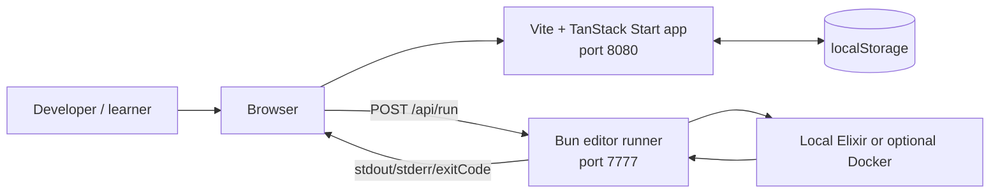
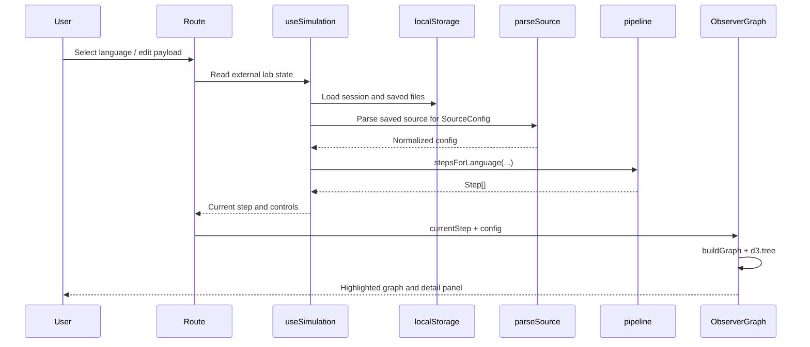

# Wire Ingest Lab — Project Architecture Blueprint

**Generated:** 2026-10-17  
**Scope:** `/home/dida/examples/wire_digest_lab/networking-lab`  
**Technology profile:** React 19, TypeScript, TanStack Start/Router, Vite, Tailwind CSS, D3 hierarchy, Vitest, Bun  
**Primary style:** Feature-oriented React application with a functional simulation core and a local process adapter  
**Diagram style:** C4-inspired component and data-flow diagrams

## 1. Executive summary

Wire Ingest Lab is a deterministic, no-network educational simulator. It follows one TCP connection from a conceptual NIC and Linux kernel path into one of four runtime models: Elixir/BEAM, Python/asyncio, Node.js/libuv, or Odin/native threads. Users edit source snippets, save them locally, and observe how a small set of parsed configuration values changes the simulation graph.

The application has two runtime surfaces:

1. **Browser application:** TanStack Start routes render the lab, observer graph, and editor. React state and browser storage hold the session and source snippets.
2. **Local Bun runner:** `runner-server.ts` exposes a deliberately small HTTP API on `127.0.0.1:7777` for executing a submitted entry file in Elixir, Python, Node.js, or Odin. `dev-all.ts` starts this process beside Vite.

The simulation is not a live socket implementation. The pipeline produces explanatory `Step` values; D3 renders a conceptual hierarchy; graph restart controls are explicitly visual-only. The only real external process execution is the local Bun runner, which supports the four allowlisted language runtimes.

## 2. System context



### Runtime responsibilities

| Boundary | Responsibility | Source of truth |
|---|---|---|
| Route/UI | User interaction, rendering, editor controls, error presentation | `src/routes`, `src/components` |
| Simulation core | Language-specific lifecycle steps and configuration interpretation | `src/lib/pipeline` |
| Persistence | Session and per-language source files | `src/lib/lab-store.ts`, `src/lib/source/persist.ts` |
| Graph projection | Runtime/kernel hierarchy and interactive layout | `src/components/observer`, `layouts.ts` |
| Local execution adapter | Validate, stage, execute, timeout, and return multi-language stdout/stderr | `runner-server.ts` |
| Process orchestration | Start/stop Vite and runner together | `dev-all.ts` |

## 3. Architectural style and principles

### 3.1 Observed style

The project is a **feature-oriented monolith in the browser** with a small sidecar process. It combines:

- **Presentation layer:** file-based routes and reusable lab/observer components.
- **Application state layer:** React hooks over a tiny external store.
- **Domain/simulation layer:** pure TypeScript transformations from `(language, payload, outcome, sourceConfig)` to `Step[]`.
- **Persistence adapter:** browser `localStorage` with migration and defaults.
- **Projection layer:** graph data builders and D3 tree layout.
- **Infrastructure adapter:** Bun HTTP/process execution for the four allowlisted language runtimes.

It is not Clean Architecture or a service-oriented production system. The educational domain is intentionally represented as pure data so it can be rendered, tested, and replayed without network access.

### 3.2 Guiding principles

1. **Determinism:** the same language, payload, outcome, and saved source produce the same steps and graph.
2. **Explicit boundaries:** source parsing is isolated in `parseSource`; the simulation consumes typed configuration rather than source text.
3. **Local-first operation:** browser storage and a loopback runner avoid a required hosted backend.
4. **Runtime-specific teaching:** Elixir, Python, Node.js, and Odin are modeled independently rather than collapsed into one generic server abstraction.
5. **Graceful degradation:** missing browser APIs, malformed persisted state, unavailable runner processes, and invalid runner requests are handled at the boundary.
6. **Visual truthfulness:** simulated actions are labeled as visual-only when they do not touch real processes.

## 4. Component architecture

```mermaid
flowchart TB
  subgraph UI[Browser UI]
    Root[__root route<br/>navigation + providers]
    Lab[/ route<br/>timeline + summary]
    Graph[/graph route<br/>full observer]
    Editor[/editor route<br/>source editor + runner]
    Controls[LabControls<br/>language, payload, timeline]
    Observer[ObserverGraph<br/>D3 tree projection]
  end

  subgraph Core[Simulation core]
    Store[useLab / useSimulation]
    Persist[Source persistence]
    Parse[parseSource]
    Pipeline[stepsForLanguage]
    Layout[buildGraph]
  end

  subgraph Runtime[Local runtime]
    Runner[runner-server.ts]
    Launcher[dev-all.ts]
    Process[Elixir, Python, Node.js, or Odin]
  end

  Root --> Lab
  Root --> Graph
  Root --> Editor
  Lab --> Controls
  Graph --> Controls
  Lab --> Observer
  Graph --> Observer
  Controls --> Store
  Store --> Persist
  Store --> Parse
  Store --> Pipeline
  Observer --> Layout
  Editor --> Persist
  Editor --> Parse
  Editor -->|HTTP JSON| Runner
  Launcher --> Runner
  Launcher --> Process
  Runner --> Process
```

## 5. Source organization

```text
.
├── runner-server.ts             # Bun loopback execution API
├── dev-all.ts                   # Bun process supervisor for local development
├── package.json                 # Bun-first commands and dependencies
├── vite.config.ts               # TanStack/Vite integration
├── src
│   ├── routes
│   │   ├── __root.tsx           # shell, providers, navigation, error/404 UI
│   │   ├── index.tsx            # primary lab page
│   │   ├── graph.tsx            # interactive observer page
│   │   └── editor.tsx           # source editor and runner client
│   ├── components
│   │   ├── lab/LabControls.tsx  # shared simulation controls and detail views
│   │   ├── observer/ObserverGraph.tsx
│   │   └── observer/layouts.ts  # language-specific graph trees
│   ├── lib
│   │   ├── lab-store.ts         # external state and simulation hook
│   │   ├── pipeline/            # typed runtime simulation
│   │   └── source/              # defaults, parser, persistence
│   ├── test/                    # Vitest and Testing Library tests
│   ├── router.tsx               # router/query-client bootstrap
│   ├── start.ts                 # client entry
│   ├── server.ts                # TanStack Start server entry
│   └── styles.css               # Tailwind and application styles
└── public/                     # static assets
```

The many files under `src/components/ui` are reusable presentation primitives. They should remain infrastructure for feature components, not become a second domain layer.

## 6. Core data model and flow

### 6.1 Domain types

`src/lib/pipeline/types.ts` defines the stable simulation vocabulary:

- `Language`: `elixir | python | nodejs | odin`
- `Outcome`: `frame | close | error`
- `Zone`: `hardware | kernel | runtime | handler | outcome`
- `SourceConfig`: normalized values extracted from source text
- `Step`: one explanatory point in the lifecycle timeline, including owner, queue, code excerpt, and highlighted graph path

The pipeline is a dispatch table:

```ts
const DISPATCH = {
  elixir: elixirSteps,
  python: pythonSteps,
  nodejs: nodejsSteps,
  odin: odinSteps,
};

stepsForLanguage(language, payload, outcome, sourceConfig);
```

Each runtime implementation in `src/lib/pipeline/{elixir,python,nodejs,odin}.ts` returns the same `Step[]` shape. This is the principal polymorphism boundary in the application.

### 6.2 Data flow



### 6.3 State ownership

| State | Owner | Persistence | Consumers |
|---|---|---|---|
| Selected language, payload, outcome | `lab-store.ts` external store | `wire-ingest-lab:session` | all routes/components |
| Saved source by language | `source/persist.ts` | `thousand-island-source-config:<language>` | editor, parser, lab |
| Unsaved editor draft | `editor.tsx` | none until Save | editor only |
| Current timeline index, playback, speed | `useSimulation` | none | lab and graph routes |
| Graph selection, collapse, pan/zoom, restart animation | `ObserverGraph` | none | graph component |
| Runner output log | `editor.tsx` | none | editor output panel |

### 6.4 Editor file and model lifecycle

Each language has a persisted `SourceFiles` map under its own localStorage key. The
default files are seeded on first load; valid user-created files are merged back
without being discarded. New, rename, and delete operations update only the
draft map. Save writes the complete map and emits the language-scoped update.

Monaco model paths are `wire-ingest/<language>/<file>`. Models are disposed when
the saved language-specific source actually changes externally or when the editor
unmounts—not when the editor receives its own Save event. This prevents a save
from replacing the controlled value with an empty newly-created model. Odin uses
a registered Monarch tokenizer and the `wire-ingest-dark` theme.

## 7. Dependency directions and boundaries

The intended dependency direction is:

```text
routes/components
        ↓
lab-store / source adapters
        ↓
pipeline types + pure runtime functions
```

The graph component additionally depends on `pipeline/types` and its local `layouts` projection. Pipeline code does not import React, browser storage, D3, or route modules. This keeps the most important educational behavior executable in unit tests without a DOM.

The local runner is a separate Bun entry point. It does not import the browser application and should not be pulled into the client bundle. Browser-to-runner communication is an HTTP JSON boundary rather than a shared module boundary. The request includes the selected language and the runner maps it to an allowlisted local binary or Docker image; it never accepts an arbitrary command or image.

### Known intentional coupling

- `editor.tsx` owns the runner URL and request shape because the runner is a development-only feature.
- `useSimulation` combines source persistence, parsing, and pipeline generation for a compact feature API.
- `layouts.ts` knows the conceptual runtime internals required by the teaching graph; this is a projection concern, not a live runtime integration.

No database, authentication, authorization, server-side session, message bus, or production service discovery mechanism exists in the current architecture.

## 8. Source parsing and persistence

### Parsing

`parseSource` is the only source-to-configuration heuristic boundary. It:

- concatenates string-valued source files;
- extracts acceptor/backlog/thread counts;
- extracts protocol prefixes and ports;
- detects Elixir `active` mode, `controlling_process`, and body validation;
- clamps numeric values through `clampCount`;
- returns `DEFAULT_CONFIG` if parsing throws.

This parser is intentionally not a language compiler. It is an educational projection from source snippets into a small simulation configuration.

### Persistence

`source/persist.ts` provides:

- language-specific keys;
- default fallback files;
- legacy key migration;
- filtering to known default file names;
- custom update events for same-tab synchronization;
- browser `storage` event support for cross-tab synchronization.

`lab-store.ts` validates persisted `language`, `outcome`, and payload types before restoring state. Browser storage failures fall back to in-memory/default behavior.

## 9. Observer graph architecture

`buildGraph(language, config)` creates a nested `GraphNode` tree:

1. A shared conceptual kernel branch models NIC, DMA, IRQ, NAPI, `sk_buff`, socket, FD table, accept queue, and readiness polling.
2. A language-specific runtime branch models supervision trees, event loops, handlers, queues, or native threads.
3. `kernelBranch` nests the runtime tree below the kernel chain so D3 can lay it out left-to-right.

`ObserverGraph` then:

- prunes collapsed subtrees;
- computes a D3 hierarchy/tree layout;
- fits the SVG to the container;
- tracks path, owner, active, selected, and restarting visual states;
- supports pointer pan, wheel zoom, keyboard node selection, collapse, and fit;
- guards `ResizeObserver` for unsupported environments.

The restart action changes CSS state for 1.6 seconds only. It must not be described or extended as process supervision.

## 10. Route and UI architecture

`src/routes/__root.tsx` is the application shell. It provides:

- document metadata and global stylesheet;
- persistent navigation;
- `QueryClientProvider`;
- TanStack Router outlet;
- not-found and route error components.

The routes are intentionally thin feature compositions:

- **`/`:** combines timeline, transport, observer preview, current-step detail, and saved-source summary.
- **`/graph`:** expands the graph and keeps the step detail panel alongside it.
- **`/editor`:** manages source tabs, drafts, save/reset, parser preview, runner requests, and output console.

`LabControls.tsx` is shared by the lab and graph routes. New simulation controls should be added there when their behavior is route-independent.

## 11. Local runner architecture

`runner-server.ts` is a Bun-native HTTP adapter:

| Endpoint | Behavior |
|---|---|
| `GET /health` | Returns `{ "ok": true }` |
| `POST /api/run` | Validates files and entry, stages files, runs Elixir, returns output |
| `OPTIONS` | Returns CORS headers for browser development |
| Other paths | Returns 404 JSON |

The request accepts `files`, `entry`, and optional `timeoutMs`. Security and reliability boundaries include:

- simple file-name validation;
- per-file byte limit of 256 KiB;
- timeout range of 100 ms to 30 seconds;
- temporary per-run directory;
- no network in Docker mode;
- CPU and memory limits in Docker mode;
- cleanup in `finally`;
- explicit JSON errors and exit metadata.

The default command is local `elixir`. `EDITOR_RUNNER_COMMAND=docker` switches to an `elixir:1.18-alpine` container. The browser's modeled Node.js runtime is unrelated to this Bun execution mechanism.

## 12. Error handling and resilience

### Browser

- Root route error UI logs the error and exposes retry/home actions.
- Malformed session/source storage is ignored in favor of validated defaults.
- Missing `ResizeObserver` does not prevent graph rendering.
- Runner fetch failures are shown in the output console with the exact runner URL and Bun startup command.
- Parser failures return default configuration rather than breaking the editor.

### Runner

- Invalid JSON produces HTTP 400.
- Invalid shape, entry, file names, or file contents produces HTTP 400.
- Process failures produce HTTP 500 with a meaningful error message.
- Timeouts return exit code `124` and `timedOut: true`.
- Child output is returned separately as stdout and stderr.

There is no retry policy, circuit breaker, centralized logging, telemetry, or remote error reporting. This is appropriate for a local educational tool; productionizing the runner would require an explicit observability and isolation design.

## 13. Security and trust boundaries

The runner is intended for localhost development, not untrusted multi-user deployment. The current boundary is:

```text
Browser editor → loopback HTTP server → local process / Docker
```

Existing mitigations reduce accidental misuse but do not make arbitrary code execution safe:

- simple file names prevent path traversal through submitted names;
- temporary directories isolate runs from the project workspace;
- Docker mode disables network and applies resource limits;
- local mode executes the host's Elixir process and therefore has host privileges.

Do not expose port `7777` publicly without authentication, strict origin policy, stronger sandboxing, resource controls, and an operational threat model. The future SSH panel is intentionally disabled and should not be implemented by sending credentials or private keys through the browser.

## 14. Testing architecture

The test suite is split by boundary:

- `src/test/pipeline.test.ts`: pure pipeline, parser, graph, and configuration behavior.
- `src/test/app-routing.test.tsx`: route matching/application routing behavior.
- `src/test/setup.ts`: test environment setup.

Recommended validation commands, all Bun-first:

```bash
bun test
bun run lint
bunx tsc -p tsconfig.app.json --noEmit
bun run build
```

Runner smoke checks should exercise both:

```bash
curl http://127.0.0.1:7777/health
curl -X POST http://127.0.0.1:7777/api/run \
  -H 'content-type: application/json' \
  --data '{"files":{"main.exs":"IO.puts \"ok\""},"entry":"main.exs"}'
```

The architecture currently has no dedicated runner unit tests, browser end-to-end suite, or accessibility regression suite. Those are the highest-value testing additions if the runner or graph becomes more complex.

## 15. Deployment and development topology

### Development

```text
bun run dev       → Vite/TanStack app, normally http://localhost:8080
bun run editor-server → Bun runner, http://127.0.0.1:7777
bun run dev:all   → starts both and forwards their output
```

### Build

`bun run build` uses the configured TanStack/Vite integration and Nitro build path. The browser app is the deployable application artifact; the local editor runner is a separate development process and should not be assumed to be available in a hosted deployment.

### Configuration

| Variable | Default | Purpose |
|---|---|---|
| `EDITOR_RUNNER_PORT` | `7777` | Runner listen port |
| `EDITOR_RUNNER_COMMAND` | local `elixir` | Set to `docker` for container execution |
| `VITE_EDITOR_RUNNER_URL` | `http://127.0.0.1:7777` | Browser runner endpoint |

## 16. Extension and evolution guide

### Add a new modeled language

1. Add the language literal and display metadata in `pipeline/types.ts`.
2. Add default source files in `source/files.ts`.
3. Implement a pure `stepsFor` function in `pipeline/<language>.ts`.
4. Register it in `pipeline/index.ts`.
5. Add source parsing rules in `source/parse.ts`.
6. Add a graph runtime layout in `observer/layouts.ts`.
7. Add focused pipeline/parser tests.
8. Verify language selection, saved-source migration, graph sizing, and editor behavior.

Keep the new implementation's output in the existing `Step` contract. Avoid putting language-specific branching into route components.

### Add a new simulation control

1. Extend the domain type only if the value changes simulation semantics.
2. Persist it in `LabState` only if it should survive reloads.
3. Add a control to `LabControls.tsx` when shared by routes.
4. Pass it into the pure pipeline function.
5. Reset or migrate persisted values defensively.
6. Add tests for each outcome and runtime where behavior differs.

### Add a new runner capability

Keep it behind the runner HTTP boundary. Validate request data before filesystem or process operations, bound time/resources, return explicit error shapes, and update the editor's output handling. Do not import Bun APIs into `src/` browser modules.

### Replace heuristics with real parsing

`parseSource` is the seam for this change. Preserve `SourceConfig` as the UI-facing contract, introduce a language-specific parser behind the same function, and keep parser errors visible in the editor rather than silently inventing configuration.

## 17. Architectural decisions and tradeoffs

### ADR-1: Pure deterministic simulation instead of live networking

- **Context:** The product teaches packet/socket lifecycle concepts without requiring privileged sockets or network setup.
- **Decision:** Represent lifecycle behavior as typed `Step[]` data and render it.
- **Benefits:** Reproducible demos, simple tests, offline operation, safe browser execution.
- **Tradeoff:** The graph is explanatory, not proof of actual runtime behavior.

### ADR-2: Browser localStorage for source and session state

- **Context:** The tool is single-user and local-first.
- **Decision:** Store source and session state in language-scoped browser keys.
- **Benefits:** No database or account system; edits persist between visits.
- **Tradeoff:** No synchronization across devices, quotas and storage failures are possible, and migrations must remain defensive.

### ADR-3: Separate Bun runner

- **Context:** Browsers cannot execute local Elixir, while hosted server execution would introduce a security and deployment boundary.
- **Decision:** Use a loopback Bun HTTP service with optional Docker execution.
- **Benefits:** Bun-native development, explicit API, simple editor integration.
- **Tradeoff:** The user must start a second process or `dev:all`; local mode is arbitrary code execution on the host.

### ADR-4: D3 hierarchy for the observer graph

- **Context:** Runtime structures are naturally trees and need collapse/layout behavior.
- **Decision:** Build nested `GraphNode` trees and use `d3-hierarchy`.
- **Benefits:** Compact layout implementation and clear parent/child semantics.
- **Tradeoff:** Very large acceptor counts can produce dense SVGs; graph performance should be monitored as configurability expands.

## 18. Governance and architectural checks

Current automated checks are:

- TypeScript strict checking with path aliases and no-emit validation.
- ESLint for source consistency and React hook rules.
- Vitest tests for pipeline and route behavior.
- Production Vite/TanStack build.

When reviewing changes, preserve these rules:

1. Keep simulation functions pure and browser-independent.
2. Keep storage and process/network effects at adapters.
3. Keep route components responsible for composition, not runtime modeling.
4. Validate all persisted and runner input at boundaries.
5. Do not describe visual graph state as a real process action.
6. Use Bun commands and APIs for project-owned local tooling.

## 19. Blueprint for new development

For a new feature, use this sequence:

1. Define or reuse a typed domain value in `src/lib`.
2. Implement pure transformation logic and tests.
3. Add persistence only when reload behavior is explicitly needed.
4. Expose the behavior through a shared component or route feature.
5. Add graph projection if the feature changes the modeled topology.
6. Add error and empty states at the UI/infrastructure boundary.
7. Run `bun test`, lint, type-check, and build.
8. Update this blueprint and `README.md` when a new runtime boundary or command is introduced.

### Common pitfalls

- Editing source text without calling `saveSource` leaves the simulation unchanged by design.
- Adding a new language in only one dispatch table creates incomplete UI behavior.
- Reading `localStorage` during server rendering breaks SSR; use the existing client guards.
- Importing `runner-server.ts` from browser code leaks Bun/process concerns into the client.
- Treating the parser as a compiler creates false confidence; it is intentionally heuristic.
- Increasing acceptor/thread counts without considering graph density can make the SVG difficult to use.
- Exposing the runner beyond loopback turns a local code executor into a security-sensitive service.

This document should be refreshed whenever the state model, pipeline contract, route topology, runner API, or deployment model changes.
